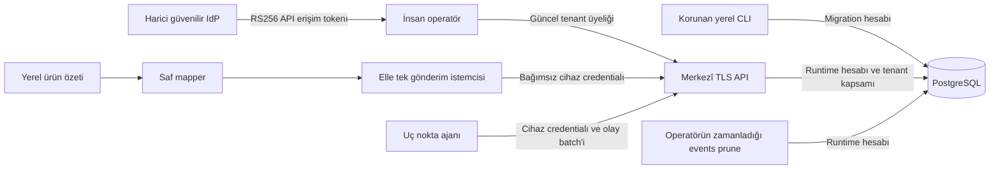

# Mimari ve güven sınırları

Termivar Platform (teknik adı `security-platform`), HostBasedFirewall'ın yanında ayrı Python/FastAPI, SQLAlchemy, Alembic ve PostgreSQL projesidir. Yerel enforcement, localhost oturumu ve Termivar Web importer burada taşınmaz. Sunucu COM/WinDivert veya Termivar Web motoru import etmeden kurulur. Platform bir durumu kaydeder; cihazın bildirdiği güvenlik sonucunu uzaktan doğrulamaz.

## İşlem akışı

IdP dış sistemdir; bu proje onu veya parola girişini uygulamaz. Üretim IdP kurulumu yoktur; testlerde geçici fixture issuer gerçek RS256 imzalı token üretir. Yerel firewall cookie/CSRF/controller anahtarı merkez kimliği olarak taşınmaz.

## Modül sınırları

| Kaynak | Sorumluluk |
|---|---|
| `app.py`, `settings.py`, `boundary.py` | Fail-closed ayarlar, transport, Host/Origin, sınırlı JSON ve route montajı |
| `auth/operator_oidc.py`, `auth/principals.py`, `api/dependencies.py` | Sabit public JWKS ile insan erişim token'ı; farklı principal türleri ve DB transaction bağımlılığı |
| `models.py`, `db.py`, `migrations/` | Gerçek PostgreSQL şeması, birleşik ilişkiler ve transaction sahipliği |
| `services/common.py` | Güncel DB üyeliği, tenant/cihaz kilitleri ve sınırlı servis ayarları |
| `services/enrollment.py`, `snapshots.py`, `inventory.py`, `audit.py` | Tek kullanımlık kayıt, credential yaşam döngüsü, son durum, sayfalama ve audit |
| `services/events.py` | Olay alımı ve cihaz imleci, cihaz başına üst sınır, zaman çizelgesi ve zamana göre saklama |
| `services/alerts.py` | Alım içinde çalışan yerleşik uyarı kuralları, tekilleştirme, cihaz başına kapanmamış uyarı sınırı; uyarı listesi, onaylama ve kapatma |
| `cli.py`, `services/administration.py` | Migration hesabıyla yerel tenant/üyelik yönetimi ve tenant olay saklama günü; TLS sunucu girişi; runtime hesabıyla `events prune` |
| `contracts.py` | Strict V1/V2 snapshot ve ürün DTO'ları (V2: Altay EDR ajanının kendi durumu `edr_agent`) |
| `event_contracts.py` | Strict `altay-edr-event/v1` olay batch'i, gizlilik maskesi kuralı ve kanonik özet |
| `connectors/hostbased_firewall/` | Saf mevcut özet eşlemesi, özel dosyalar ve elle tek gönderim |

Principal yetkisi veya token mantığı tek büyük route dosyasına konmaz. V1 kayıt hakkı ve cihaz digest işlemleri `services/enrollment.py` içinde birleştirilmiştir; ayrı `device_tokens.py` modülü bulunduğu iddia edilmez.

## Tenant verisi ve roller

Tablolar: olay saklama gününü de (`event_retention_days`) tutan `tenants`, global `(issuer, subject)` anahtarlı `principals`, tenant'a bağlı `memberships`, `enrollment_grants`, `devices`, `device_credentials`, `product_states`, `device_event_cursors`, `endpoint_events`, `alerts`, `audit_events`. Tenant'a ait kayıtta `tenant_id` zorunludur. Credential, ürün, olay imleci, olay ve uyarı satırları `(tenant_id, device_id)` birleşik foreign key'i ile aynı tenant cihazına bağlanır. Kayıt hakkını oluşturan, uyarıyı onaylayan ve kapatan principal da `(tenant_id, principal_id)` üyeliğine bağlanır.

`viewer` kendi tenant'ının cihazlarını, olaylarını ve uyarılarını okur. `tenant_admin` buna ek olarak kayıt hakkı üretir/iptal eder, cihazı iptal eder, uyarıyı onaylar/kapatır ve audit okur. Aynı insan iki tenant'ta farklı role sahip olabilir. Güncel üyelik her istek transaction'ında DB'den okunur; token rolleri veya e-posta alan adı üyelik oluşturmaz. Başka tenant nesneleri, ilgili üyelik yoksa tutarlı 404 ile gizlenir; kendi tenant'ında yetersiz rol 403'tür.

Sorgular tenant bağlamını açıkça taşır. UUID tahmin edilemezliği yetkilendirme değildir. RLS uygulanmış olduğu iddia edilmez: izolasyon servis sorgu kapsamı ve birleşik ilişkilerle sağlanır. SQL runtime credential'ı veya sunucu süreci ele geçirilirse uygulama tenant sınırı atlanabilir; tehdit modeli bunu ayrı ele alır.

## Atomiklik ve yarışlar

FastAPI DB bağımlılığı `scope='function'` kullanır: transaction/commit, başarılı cevap gönderilmeden tamamlanır. Mutation ve başarılı audit aynı transaction'dadır. Audit veya DB hatası cihaz/credential/hak üzerinde yarım başarı bırakmaz.

Tenant satır kilidi kayıt kotası, kayıt hakkı, rotasyon, iptal ve yerel üyelik değişimini sıralar. Cihaz ve credential satırları snapshot/rotasyonda yeniden kilitlenip güncel iptal/süre durumu okunur. Auth aşamasındaki kontrol tek başına mutation yetkisi sayılmaz. İptal commit'inden sonra başlayan snapshot reddedilir. Daha önce başlamış gerçek ağ işlemlerinin geri alınabildiği iddia edilmez.

Tek kayıt hakkı tüketimi, cihaz, credential ve audit tek transaction'dadır; yarışan iki istekte en çok biri başarılı olur. Rotasyonda yeni credential ve eskisinin iptali birlikte commit edilir; eski credential ile paralel rotasyon en çok bir yeni sır üretir. Sırlar DB'de SHA256 digest olarak saklanır; 32 rastgele baytlık opaque değerlerin plaintext önbelleği yoktur.

## Son snapshot, sıra ve tazelik

Her cihazda yalnız son sıra, mesaj UUID'si, kanonik içerik SHA256 değeri ve sunucunun `received_at` zamanı tutulur. Aynı son sıra/UUID/içeriğin tekrarı aynı kabul cevabını döndürür; tazelik, sayaç veya audit eklenmez. Aynı sıra veya son UUID farklı içerikle 409'dur. Daha eski sıra ve aşılmış eski tekrar 409'dur. Cihaz credential rotasyonu veya istemci restart'ı sıra dönemini sıfırlamaz.

Ürünler tam son durum olarak değiştirilir. Yeni snapshot'ta bulunmayan ürün eski gözlemle yaşatılmaz; detayda `missing_products` içinde gösterilir. Son durum sayaçtır; her aktarımda önceki sayıya eklenmez. Atomik validation olmadan kısmi ürün yazımı yapılmaz.

Bağlantı durumu sunucu zamanından hesaplanır: ilk snapshot öncesi `never_seen`; API varsayılanında son kabulden 90 saniyeye kadar `recent`; sonra `stale`. Cihaz saati bunu değiştirmez. `identity_status=active|revoked` bağlantı durumundan ayrıdır. Kaynak zamanı yoksa yaş `unknown`; gelecekse `future` olur. Kaynağın doğruluğu `not_verified` kalır.

## Olaylar, imleç ve saklama

Olay batch'leri snapshot ile aynı kimlik ve sıra ilkesini izler. Alım işlemi önce cihaz ve credential satırlarını, sonra cihazın `device_event_cursors` satırını `FOR UPDATE` ile kilitler; böylece bir cihazın batch'leri sıralanır. İmleç son batch'in sırasını, UUID'sini, kanonik içerik özetini, son `event_seq` değerini, sunucunun alış zamanını, cihazın saklanan satır sayısını (`stored_events`) ve cihaz başına üst sınırın sildiği satırların toplamını (`cap_deleted_events`; zaman çizelgesi cevabında döner) tutar. `devices` tablosuna sütun eklenmez. Son batch'in tam tekrarı saklanan cevabı alır; diğer çakışmalar 409'dur. Satır ekleme, cihaz başına üst sınır silmesi ve imleç güncellemesi tek transaction'dadır.

`endpoint_events` satırı kanonik olayı JSONB olarak, cihaz saati `observed_at` ve sunucu saati `received_at` ile ayrı tutar. Cihaz saati tazelik veya saklama kararı vermez. Olay alımı snapshot `connection_status` değerini değiştirmez ve yüksek hacim nedeniyle audit yazmaz. Her olay `self_reported` ve `not_verified` kalır. Runtime hesabı olay satırlarını güncelleyemez; DELETE yalnız cihaz başına üst sınır ve saklama içindir.

Zamana göre saklama operatörün zamanladığı `security-platform events prune` komutudur; arka plan işi veya zamanlayıcı süreç yoktur. Komut her tenant için `received_at` değeri `event_retention_days` (varsayılan 30, 1–90) günden eski satırları `(tenant_id, received_at)` indeksiyle en çok 5000 satırlık parçalar hâlinde siler; her parça kendi kısa transaction'ıdır. Kilit sırası alımla aynıdır: önce ilgili cihazların imleçleri (cihaz kimliğine göre sıralı), sonra olay satırları. Bu yüzden komut alımla veya paralel çalışan başka bir prune ile kilitlenmeye (deadlock) girmez. `stored_events` aynı transaction'da silinen satır sayısı kadar düşürülür; böylece sınırdaki bir cihazın alımı gereğinden fazla satır silmez. `cap_deleted_events` değişmez; yalnız alış sırasındaki üst sınır silmelerini sayar. Komut çalıştırılmazsa yalnız cihaz başına üst sınır korur.

## Uyarılar

Yerleşik kurallar (`services/alerts.py`) olay alımının içinde, aynı transaction'da ve yalnız yeni kabul edilen batch'in olayları için çalışır; olaylar ve uyarıları birlikte commit edilir. Tam tekrar, 409, 413 ve 422 kural çalıştırmaz. Kurallar üst süreci önce batch'te, sonra cihazın önceki 2000 `event_seq` aralığındaki saklanan olaylarında arar; bu arama birincil anahtarın tek bir aralığıdır ve cihaz başına üst sınır silmesinden önce yapılır. Kapanmamış (`open`/`acknowledged`) bir uyarının anahtarı tekrar eşleşirse uyarı güncellenir: her farklı anahtar, `status <> 'closed'` kısmi tekil indeksine karşı tek bir `INSERT … ON CONFLICT` deyimidir. Cihaz satırı kilidi bir cihazın bütün açılışlarını sıralar; operatör yalnız onaylar veya kapatır. Bu yüzden bir kapatma ile aynı anahtarın alımı yarışırsa sonuç ya kapalı uyarı ile yeni açık bir uyarı ya da eşleşmeyi içeren kapalı uyarıdır; iki kapanmamış uyarı oluşmaz. Cihaz başına kapanmamış uyarı sınırı (`SP_MAX_OPEN_ALERTS_PER_DEVICE`) yalnız yeni açılışları bastırır ve bunları imleçteki `suppressed_alerts` sayacına yazar. Onaylama ve kapatma tenant satırı kilidi, `tenant_admin` üyeliği ve uyarı satırı kilidiyle yapılır ve audit'e yazılır. Uyarılar `self_reported`/`not_verified` kalır, silinmez (saklama süresi yok) ve kural tespiti teşhis değildir; ayrıntı [API V1](API_V1.tr.md) içindedir.

## Yerel özetin anlamı

Mapper yalnız mevcut `security_ecosystem.py` ürün/özet sözleşmesini okur. HostBasedFirewall'ın katalog girdisi motor gözleminin zamanını sunmadığından mapper zaman uydurmaz; kurulum durumu da gözlenmiyorsa `null` kalır. `enforce` bildirimi merkez tarafından canlı paket engelleme kanıtı sayılmaz.

Yerel UI'daki **Ürün özetini indir** düğmesi mevcut authenticated `GET /ecosystem` çağrısını yapıp `ecosystem-overview.json` dosyası üretir. Anonim export route'u, merkezî gönderim veya yerel backend yazımı eklenmez. Kullanıcı bu dosyayı ayrı sender'a açıkça seçer; local cookie/CSRF/controller bilgisi özetin parçası değildir.

Termivar Web'de mevcut en son sayısal özet taşınır. Ham rapor, hedef, kanıt, HTML veya dosya yolu gönderilmez. Yerel `imported_at` raporun üretim zamanı değildir. `self_reported/not_verified` korunur; rapor bulunması scanner kurulu/çalışıyor anlamına gelmez. Antivirüs `planned/unavailable` kalır; V1 aktif AV iddiasını reddeder.

İstemci gönderimden önce pending DTO'yu özel dosyaya atomik kaydeder; cevabı doğrulamadan sırayı artırmaz. Restart'ta pending varsa aynı mesaj gönderilir. İstemci yalnız kendi ayrı state dosyasını yazar; yerel firewall ayarı veya rapor deposu yazarı değildir. Merkez kapalıyken sender hata verir ve pending'i korur; firewall yaşam döngüsünü çağırmaz.

## İşletim sınırı

API ayrı runtime hesabı kullanır; migration/yerel bootstrap hesabı şema sahibidir. Runtime'ın audit DELETE hakkı yalnız bounded tenant retention içindir; cryptographic immutability sağlamaz. `endpoint_events` için DELETE yalnız cihaz başına üst sınır (`SP_MAX_EVENTS_PER_DEVICE`, varsayılan 250.000) ve `events prune` içindir; UPDATE verilmez. `alerts` için DELETE verilmez. Tenant'ın saklama gününü runtime hesabı değiştiremez. Audit en çok varsayılan 10.000 kayıt/tenant, credential geçmişi 16/cihaz, kayıt hakkı geçmişi 2.000/tenant ile sınırlıdır. Aktif hak ve aktif cihaz varsayılanı ayrı ayrı 1.000/tenant'tır. İptal edilmiş cihazlar kotadan düşer; böylece iptal ve yeniden kayıt kurtarma yolu tenant'ı kilitlemez. İptal edilmiş satırlar geçmiş olarak kalır ve silme komutu yoktur. Cihaz listesi en fazla 10.000 offset ile sayfalandığından, çok sayıda iptal birikirse en yeni cihazlar listede görünmeyebilir. Bu durumda doğrudan cihaz kimliğiyle erişilir ve audit kaydındaki `device_enrolled` olayları kullanılır.

Canonical Alembic yapılandırması ve migration dosyaları source ağacında tutulur; wheel'de aynı dosyalar `share/security-platform` kurulum verisi olarak taşınır. CLI önce source yerleşimini, sonra kurulu prefix'i denetler. Migration kaynakları eksikse hata verir; `create_all` ile sürümsüz alternatif şema kurmaz. Build aracı ayrı `requirements-build-lock.txt` ile sabitlenir.

Request limiti süreç/IP başına varsayılan 120/dakikadır, 1.024 kaynak kovası saklanır. Bu dağıtık DDoS sınırı değildir. Public JWKS güvenilir dosyadan başlangıçta okunur; anahtar yenileme kontrollü dosya değişimi ve servis restart'ı ister. Host ve Origin ayrı browser/transport sınırlarıdır; kullanıcı ve cihaz yetkisi bearer principal ile belirlenir.
