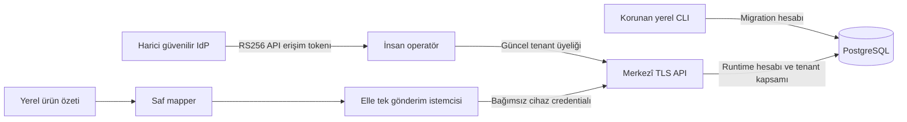

# Mimari ve güven sınırları

`security-platform`, HostBasedFirewall'ın yanında ayrı Python/FastAPI, SQLAlchemy, Alembic ve PostgreSQL projesidir. Yerel enforcement, localhost oturumu ve Termivar importer burada taşınmaz. Sunucu COM/WinDivert veya Termivar motoru import etmeden kurulur. Platform bir durumu kaydeder; cihazın bildirdiği güvenlik sonucunu uzaktan doğrulamaz.

## İşlem akışı

IdP dış sistemdir; bu proje onu veya parola girişini uygulamaz. Üretim IdP kurulumu yoktur; testlerde geçici fixture issuer gerçek RS256 imzalı token üretir. Yerel firewall cookie/CSRF/controller anahtarı merkez kimliği olarak taşınmaz.

## Modül sınırları

| Kaynak | Sorumluluk |
|---|---|
| `app.py`, `settings.py`, `boundary.py` | Fail-closed ayarlar, transport, Host/Origin, sınırlı JSON ve route montajı |
| `auth/operator_oidc.py`, `auth/principals.py`, `api/dependencies.py` | Sabit public JWKS ile insan erişim token'ı; farklı principal türleri ve DB transaction bağımlılığı |
| `models.py`, `db.py`, `migrations/` | Gerçek PostgreSQL şeması, birleşik ilişkiler ve transaction sahipliği |
| `services/common.py` | Güncel DB üyeliği, tenant/cihaz kilitleri ve sınırlı servis ayarları |
| `services/enrollment.py`, `snapshots.py`, `inventory.py`, `audit.py` | Tek kullanımlık kayıt, credential yaşam döngüsü, son durum, sayfalama ve audit |
| `cli.py`, `services/administration.py` | Migration hesabıyla yerel tenant/üyelik yönetimi ve TLS sunucu girişi |
| `contracts.py` | Strict V1 snapshot ve ürün DTO'ları |
| `connectors/hostbased_firewall/` | Saf mevcut özet eşlemesi, özel dosyalar ve elle tek gönderim |

Principal yetkisi veya token mantığı tek büyük route dosyasına konmaz. V1 kayıt hakkı ve cihaz digest işlemleri `services/enrollment.py` içinde birleştirilmiştir; ayrı `device_tokens.py` modülü bulunduğu iddia edilmez.

## Tenant verisi ve roller

Tablolar: `tenants`, global `(issuer, subject)` anahtarlı `principals`, tenant'a bağlı `memberships`, `enrollment_grants`, `devices`, `device_credentials`, `product_states`, `audit_events`. Tenant'a ait kayıtta `tenant_id` zorunludur. Credential ve ürün satırları `(tenant_id, device_id)` birleşik foreign key'i ile aynı tenant cihazına bağlanır. Kayıt hakkını oluşturan principal da `(tenant_id, principal_id)` üyeliğine bağlanır.

`viewer` kendi tenant'ının cihazlarını okur. `tenant_admin` buna ek olarak kayıt hakkı üretir/iptal eder, cihazı iptal eder ve audit okur. Aynı insan iki tenant'ta farklı role sahip olabilir. Güncel üyelik her istek transaction'ında DB'den okunur; token rolleri veya e-posta alan adı üyelik oluşturmaz. Başka tenant nesneleri, ilgili üyelik yoksa tutarlı 404 ile gizlenir; kendi tenant'ında yetersiz rol 403'tür.

Sorgular tenant bağlamını açıkça taşır. UUID tahmin edilemezliği yetkilendirme değildir. RLS uygulanmış olduğu iddia edilmez: izolasyon servis sorgu kapsamı ve birleşik ilişkilerle sağlanır. SQL runtime credential'ı veya sunucu süreci ele geçirilirse uygulama tenant sınırı atlanabilir; tehdit modeli bunu ayrı ele alır.

## Atomiklik ve yarışlar

FastAPI DB bağımlılığı `scope='function'` kullanır: transaction/commit, başarılı cevap gönderilmeden tamamlanır. Mutation ve başarılı audit aynı transaction'dadır. Audit veya DB hatası cihaz/credential/hak üzerinde yarım başarı bırakmaz.

Tenant satır kilidi kayıt kotası, kayıt hakkı, rotasyon, iptal ve yerel üyelik değişimini sıralar. Cihaz ve credential satırları snapshot/rotasyonda yeniden kilitlenip güncel iptal/süre durumu okunur. Auth aşamasındaki kontrol tek başına mutation yetkisi sayılmaz. İptal commit'inden sonra başlayan snapshot reddedilir. Daha önce başlamış gerçek ağ işlemlerinin geri alınabildiği iddia edilmez.

Tek kayıt hakkı tüketimi, cihaz, credential ve audit tek transaction'dadır; yarışan iki istekte en çok biri başarılı olur. Rotasyonda yeni credential ve eskisinin iptali birlikte commit edilir; eski credential ile paralel rotasyon en çok bir yeni sır üretir. Sırlar DB'de SHA256 digest olarak saklanır; 32 rastgele baytlık opaque değerlerin plaintext önbelleği yoktur.

## Son snapshot, sıra ve tazelik

Her cihazda yalnız son sıra, mesaj UUID'si, kanonik içerik SHA256 değeri ve sunucunun `received_at` zamanı tutulur. Aynı son sıra/UUID/içeriğin tekrarı aynı kabul cevabını döndürür; tazelik, sayaç veya audit eklenmez. Aynı sıra veya son UUID farklı içerikle 409'dur. Daha eski sıra ve aşılmış eski tekrar 409'dur. Cihaz credential rotasyonu veya istemci restart'ı sıra dönemini sıfırlamaz.

Ürünler tam son durum olarak değiştirilir. Yeni snapshot'ta bulunmayan ürün eski gözlemle yaşatılmaz; detayda `missing_products` içinde gösterilir. Son durum sayaçtır; her aktarımda önceki sayıya eklenmez. Atomik validation olmadan kısmi ürün yazımı yapılmaz.

Bağlantı durumu sunucu zamanından hesaplanır: ilk snapshot öncesi `never_seen`; API varsayılanında son kabulden 90 saniyeye kadar `recent`; sonra `stale`. Cihaz saati bunu değiştirmez. `identity_status=active|revoked` bağlantı durumundan ayrıdır. Kaynak zamanı yoksa yaş `unknown`; gelecekse `future` olur. Kaynağın doğruluğu `not_verified` kalır.

## Yerel özetin anlamı

Mapper yalnız mevcut `security_ecosystem.py` ürün/özet sözleşmesini okur. HostBasedFirewall'ın katalog girdisi motor gözleminin zamanını sunmadığından mapper zaman uydurmaz; kurulum durumu da gözlenmiyorsa `null` kalır. `enforce` bildirimi merkez tarafından canlı paket engelleme kanıtı sayılmaz.

Yerel UI'daki **Ürün özetini indir** düğmesi mevcut authenticated `GET /ecosystem` çağrısını yapıp `ecosystem-overview.json` dosyası üretir. Anonim export route'u, merkezî gönderim veya yerel backend yazımı eklenmez. Kullanıcı bu dosyayı ayrı sender'a açıkça seçer; local cookie/CSRF/controller bilgisi özetin parçası değildir.

Termivar'da mevcut en son sayısal özet taşınır. Ham rapor, hedef, kanıt, HTML veya dosya yolu gönderilmez. Yerel `imported_at` raporun üretim zamanı değildir. `self_reported/not_verified` korunur; rapor bulunması scanner kurulu/çalışıyor anlamına gelmez. Antivirüs `planned/unavailable` kalır; V1 aktif AV iddiasını reddeder.

İstemci gönderimden önce pending DTO'yu özel dosyaya atomik kaydeder; cevabı doğrulamadan sırayı artırmaz. Restart'ta pending varsa aynı mesaj gönderilir. İstemci yalnız kendi ayrı state dosyasını yazar; yerel firewall ayarı veya rapor deposu yazarı değildir. Merkez kapalıyken sender hata verir ve pending'i korur; firewall yaşam döngüsünü çağırmaz.

## İşletim sınırı

API ayrı runtime hesabı kullanır; migration/yerel bootstrap hesabı şema sahibidir. Runtime'ın audit DELETE hakkı yalnız bounded tenant retention içindir; cryptographic immutability sağlamaz. Audit en çok varsayılan 10.000 kayıt/tenant, credential geçmişi 16/cihaz, kayıt hakkı geçmişi 2.000/tenant ile sınırlıdır. Aktif hak ve aktif cihaz varsayılanı ayrı ayrı 1.000/tenant'tır. İptal edilmiş cihazlar kotadan düşer; böylece iptal ve yeniden kayıt kurtarma yolu tenant'ı kilitlemez. İptal edilmiş satırlar geçmiş olarak kalır ve silme komutu yoktur. Cihaz listesi en fazla 10.000 offset ile sayfalandığından, çok sayıda iptal birikirse en yeni cihazlar listede görünmeyebilir. Bu durumda doğrudan cihaz kimliğiyle erişilir ve audit kaydındaki `device_enrolled` olayları kullanılır.

Canonical Alembic yapılandırması ve migration dosyaları source ağacında tutulur; wheel'de aynı dosyalar `share/security-platform` kurulum verisi olarak taşınır. CLI önce source yerleşimini, sonra kurulu prefix'i denetler. Migration kaynakları eksikse hata verir; `create_all` ile sürümsüz alternatif şema kurmaz. Build aracı ayrı `requirements-build-lock.txt` ile sabitlenir.

Request limiti süreç/IP başına varsayılan 120/dakikadır, 1.024 kaynak kovası saklanır. Bu dağıtık DDoS sınırı değildir. Public JWKS güvenilir dosyadan başlangıçta okunur; anahtar yenileme kontrollü dosya değişimi ve servis restart'ı ister. Host ve Origin ayrı browser/transport sınırlarıdır; kullanıcı ve cihaz yetkisi bearer principal ile belirlenir.
